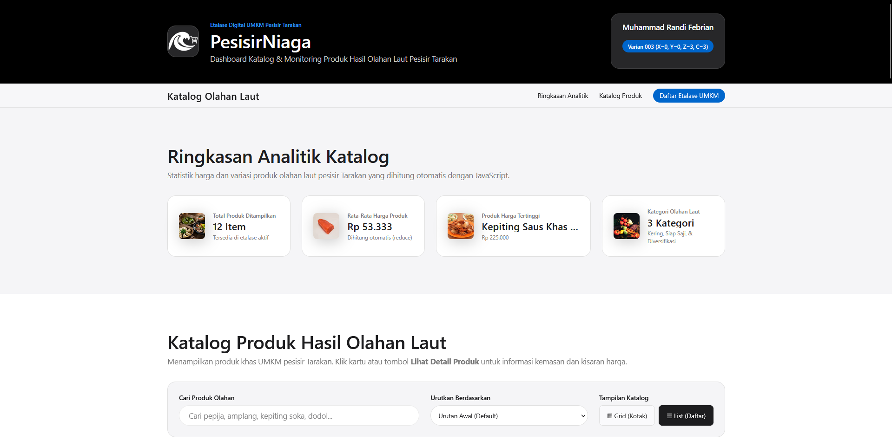
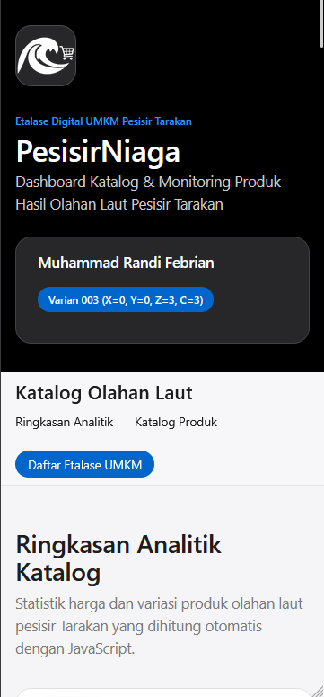

# PesisirNiaga — Dashboard Katalog & Monitoring Suplai Produk UMKM Pesisir Tarakan

## 1. Identitas Mahasiswa
- **Nama:** Muhammad Randi Febrian
- **NIM:** 2440304003
- **Program Studi / Semester:** Teknik Komputer / Semester 5
- **Mata Kuliah:** Pemrograman Web (26TJ453127)

## 2. Nama Aplikasi dan Deskripsi Singkat
**PesisirNiaga** adalah aplikasi *Interactive Data Dashboard* berbasis REST API yang dirancang untuk membantu pengurus koperasi dan pelaku UMKM di kawasan pesisir Kota Tarakan (seperti wilayah Tanjung Batu dan Mamburungan) dalam memantau katalog harga suplai barang, menganalisis statistik harga produk secara *real-time*, serta mengajukan preferensi kategori pasokan barang.

## 3. Perhitungan Variasi Soal Berdasarkan NIM
Tiga digit terakhir NIM **2440304003** adalah **003**:
- **Digit X = 0** → Dataset: **Products** | Tema: **Dashboard Produk / UMKM**
- **Digit Y = 0** → Fitur Utama: **Search real-time + sorting**
- **Digit Z = 3** → Form & Validasi: **Minimal satu kategori/preferensi dipilih**
- **Nilai S** = X + Y + Z = 0 + 0 + 3 = **3**
- **Challenge C** = S mod 4 = 3 mod 4 = **3** → **Toggle Grid/List; pilihan pengguna disimpan pada `localStorage`**

## 4. Dataset / REST API yang Digunakan
- **Sumber API:** DummyJSON Products REST API
- **Endpoint Utama:** `https://dummyjson.com/products`
- **Metode HTTP:** `GET`

## 5. Fitur Utama dan Challenge
1. **Analisis Data Otomatis:** Menampilkan rata-rata harga produk, produk dengan harga tertinggi, dan total kategori unik yang dihitung secara dinamis menggunakan metode array JavaScript.
2. **Search Real-Time & Sorting (Y=0):** Pencarian produk langsung saat pengguna mengetik kata kunci, dikombinasikan dengan pengurutan berdasarkan harga maupun nama produk.
3. **Toggle Grid/List dengan Web Storage (C=3):** Mengubah tata letak katalog antara tampilan *Grid* (kartu) dan *List* (baris daftar), serta menyimpan preferensi pengguna di `localStorage`.
4. **Form Preferensi Suplai & Validasi Client-Side (Z=3):** Formulir pengajuan suplai mitra UMKM yang memvalidasi input wajib serta memastikan minimal satu *checkbox* kategori produk dipilih.

## 6. Cara Menjalankan Project
1. Letakkan folder proyek di dalam direktori server lokal Laragon (`C:\laragon\www\pts-pemweb-2440304003`).
2. Jalankan Laragon dan pastikan layanan Apache aktif.
3. Buka browser dan akses melalui URL `http://localhost/pts-pemweb-2440304003/`.

## 7. Screenshot Desktop dan Mobile

**Tampilan Desktop (Grid View):**

**Tampilan Mobile (Responsive):**

## 8. Jawaban 10 Pertanyaan Penjelasan Kode
1. Jelaskan alur sejak halaman dibuka sampai data REST API tampil. Sebutkan nama fungsi pada project Anda.
Ketika halaman pertama kali dibuka, event listener DOMContentLoaded akan langsung memanggil fungsi utama bernama fetchProducts(). Di dalam fungsi ini, status loading diaktifkan menggunakan renderLoadingState(). Kemudian, fetch() mengambil data dari [dummyjson.com/products](https://dummyjson.com/products). Setelah JSON diterima, data tersebut di-mapping (digabungkan) dengan array TARAKAN_SEAFOOD_CATALOG lalu disimpan di appState.allProducts. Terakhir, status loading dihilangkan dan data dikirim ke fungsi renderAnalytics() untuk menghitung statistik, serta renderProducts() untuk merender kartu HTML ke DOM.

2. Mengapa setelah fetch() selesai Anda masih perlu memeriksa response.ok? Jelaskan dengan kasus pada aplikasi Anda.
Metode fetch() pada JavaScript hanya akan menghasilkan status reject (gagal) jika terjadi masalah jaringan seperti terputusnya koneksi internet. Jika server API berhasil merespons tetapi halamannya tidak ditemukan (HTTP 404) atau servernya down (HTTP 500), fetch() tetap menganggapnya sebagai resolve (berhasil). Oleh karena itu, pengecekan if (!response.ok) wajib dilakukan agar aplikasi bisa melempar error secara manual (throw new Error) jika status HTTP tidak berada di rentang 200-299, sehingga program tidak keliru memproses halaman error (HTML) sebagai data JSON.

3. Pilih satu data JSON dari API dan jelaskan bagaimana data tersebut diubah menjadi elemen DOM yang terlihat.
Saya mengambil contoh data produk yang telah di-mapping: { id: 1, title: 'Ikan Tipis Goreng', price: 30000, thumbnail: 'url-gambar' }. Data ini masuk ke dalam parameter fungsi renderProducts(products). Di dalam fungsi tersebut, sebuah perulangan .forEach() akan membuat elemen pembungkus <article class="product-card"> menggunakan document.createElement(). Selanjutnya, properti thumbnail dimasukkan ke img.src, properti title dimasukkan ke h3.textContent, dan properti price diformat menggunakan fungsi formatRupiah() lalu dimasukkan ke elemen span. Setelah seluruh komponen kartu tersusun di memori, kartu tersebut digabungkan ke layar menggunakan perintah container.append(article).

4. Apa yang terjadi jika internet terputus, endpoint salah, atau server mengembalikan HTTP 404/500? Jelaskan penanganannya.
Jika hal tersebut terjadi, blok try di dalam fungsi fetchProducts() akan langsung terhenti dan melempar eksekusi ke blok catch (error). Di blok catch ini, fungsi penanganan renderErrorState(error.message) dipanggil. Fungsi ini akan menyembunyikan kontainer produk dan memunculkan elemen .status-box berwarna merah di layar yang berisi pesan peringatan gagal memuat data, beserta sebuah tombol "Coba Lagi" (#btn-retry) untuk memicu ulang fungsi fetchProducts() ketika koneksi membaik.

5. Jelaskan bagaimana fitur berdasarkan digit Y bekerja. Cantumkan nama fungsi/event yang digunakan.
Sesuai Varian Y=0, fitur Search dan Sort berjalan secara real-time. Fitur ini menggunakan pendengar event input pada kotak pencarian (domElements.searchInput) dan event change pada dropdown pengurutan (domElements.sortSelect). Keduanya bermuara pada satu fungsi utama yaitu applyFilterAndSort(). Fungsi ini bekerja dua tahap: pertama memfilter array appState.allProducts menggunakan .filter() untuk mencocokkan kata kunci, lalu mengurutkan hasilnya menggunakan metode .sort() (berdasarkan harga atau abjad abjad). Hasil akhirnya disimpan di appState.filteredProducts dan dikirim kembali ke renderProducts() untuk ditampilkan.

6. Jelaskan bagaimana validasi berdasarkan digit Z bekerja dan mengapa input tidak valid tidak boleh langsung diproses.
Validasi Z=3 mewajibkan minimal 1 kategori dipilih. Fitur ini berjalan saat event submit pada form memicu fungsi validateSupplyForm(event). Fungsi ini mencegah perilaku default menggunakan event.preventDefault(). Validasi menggunakan querySelectorAll('input[name="categories"]:checked'). Jika length dari elemen tersebut adalah 0 (tidak ada yang dicentang), maka variabel isValid menjadi false dan teks error merah ditampilkan ke layar. Input tidak valid tidak boleh diproses untuk mencegah integritas data yang buruk terkirim ke server (database), yang dapat menyebabkan backend error atau data kosong (kategori null).

7. Jika project Anda menggunakan localStorage, jelaskan data apa yang disimpan, kapan dibaca/diubah, dan alasan penggunaannya.
Sesuai Varian C=3, aplikasi PesisirNiaga menyimpan data berupa teks string 'grid' atau 'list' pada localStorage dengan kunci pesisirniaga_view_mode. Data dibaca satu kali di awal saat deklarasi appState.viewMode atau ketika halaman dimuat ulang. Data diubah/ditimpa (setItem) kapan saja pengguna mengklik tombol toggle melalui fungsi setViewMode(mode). Alasan penggunaannya adalah untuk memberikan pengalaman pengguna (UX) yang baik; preferensi tata letak yang dipilih pengunjung akan persisten dan tidak kembali ke default meski mereka menutup atau me-refresh browser.

8. Pilih satu fungsi JavaScript penting, lampirkan potongan maksimal 15 baris, lalu jelaskan input - proses - output.
function setViewMode(mode) {
            // Update state & localStorage
            appState.viewMode = mode;
            localStorage.setItem(API_CONFIG.STORAGE_KEY_VIEW, mode);

            // Update DOM Classes
            if (mode === 'list') {
                domElements.productContainer.classList.remove('grid-view');
                domElements.productContainer.classList.add('list-view');
            } else {
                domElements.productContainer.classList.remove('list-view');
                domElements.productContainer.classList.add('grid-view');
            }
            }
input: Nilai mode bertipe string, yaitu 'grid' atau 'list'.

Proses: Memperbarui variabel state internal, menyimpan pilihan ke localStorage, lalu menghapus dan menambahkan class CSS spesifik pada DOM container produk.

Output: Secara visual antarmuka pengguna berubah bentuk layoutnya, dan secara sistematis preferensi tersebut tersimpan permanen di memori browser.

9. Sebutkan bug/error paling sulit selama PTS, penyebabnya, cara menemukannya, dan cara memperbaikinya.
Bug yang paling menyita waktu adalah logo PesisirNiaga yang gagal dimuat (pecah) saat dijalankan di browser Firefox, padahal kodenya terlihat benar. Penyebabnya adalah penggunaan atribut absolute path (C:/laragon/...) pada atribut gambar. Sistem keamanan Firefox secara ketat memblokir akses file lokal langsung ketika dibuka via localhost (isu CORS/Security). Saya menemukannya dengan melihat log error di DevTools Console. Perbaikannya adalah dengan menghapus teks C:/... tersebut dan murni menggunakan relative path (assets/pesisir-niaga.png).

10. Jika diberi satu minggu lagi, sebutkan dua perbaikan teknis yang akan Anda lakukan dan alasannya.

    Menerapkan Fitur Pagination atau Infinite Scroll: Saat ini data dirender sekaligus. Jika API DummyJSON nanti mengembalikan 100 atau 1000 produk, browser bisa mengalami lagging atau lambat merender DOM. Pagination akan membagi pemuatan data (misal 10 per halaman) agar performa tetap ringan.

    Mensimulasikan POST Request pada Form UMKM: Saat ini form validasi hanya berakhir pada notifikasi sukses secara lokal di layar. Saya ingin menambahkan perintah fetch(url, { method: 'POST' }) ke endpoint /add DummyJSON untuk mengirim objek data formulir secara asinkron, agar pengalaman integrasi backend API menjadi komprehensif dua arah (GET dan POST).

## 9. AI Usage Log
| Tanggal | AI/Tool | Tujuan | Prompt/Ringkasan | Bagian Digunakan | Verifikasi/Modifikasi |
| :--- | :--- | :--- | :--- | :--- | :--- |
| 15-16 Okt 2026 | Google Gemini | Brainstorming konteks aplikasi, pemetaan varian NIM 003, dan penyusunan struktur awal proyek | Diskusi penyesuaian tema UMKM Pesisir Tarakan dengan dataset DummyJSON Products serta pembuatan kerangka HTML5 semantik | Kerangka awal `index.html`, variabel dasar `css/styles.css`, dan draf `README.md` | Diuji pada localhost, disesuaikan teks identitas/footer dan struktur elemen semantik. |
| 16 Okt 2026 | Google Gemini | Implementasi Fetch API (X=0) & Data Mapping produk lokal | Meminta panduan penggunaan `async/await` ke endpoint DummyJSON dan cara mapping data API dengan array `TARAKAN_SEAFOOD_CATALOG` | Fungsi `fetchProducts()` dan logika `.map()` di `js/app.js` | Menyesuaikan nama variabel dan memastikan *Network Tab* tetap memanggil endpoint wajib. |
| 16 Okt 2026 | Google Gemini | Logika fitur Search, Sort (Y=0), LocalStorage (C=3), & Validasi Form (Z=3) | Meminta referensi sintaks array `.filter()`, `.sort()`, `localStorage.setItem`, dan selektor DOM `:checked` untuk validasi form | Fungsi `applyFilterAndSort()`, `setViewMode()`, dan `validateSupplyForm()` di `js/app.js` | Mengubah *ID* elemen agar terhubung dengan HTML, mengubah teks *error*, dan menguji *edge case*. |
| 16 Okt 2026 | Google Gemini | Troubleshooting kompatibilitas browser (Firefox) | Menanyakan penyebab gambar logo dengan *absolute path* (`C:/laragon/...`) diblokir oleh sistem keamanan Firefox | Perbaikan tag `` pada `index.html` | Mengubah *absolute path* menjadi *relative path* (`assets/pesisir-niaga.png`) dan mengujinya ulang. |